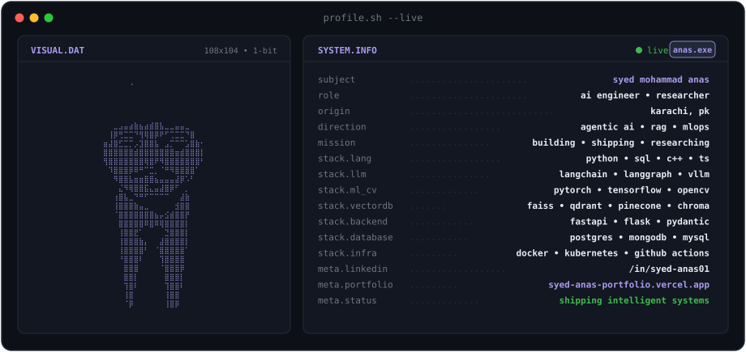
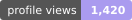
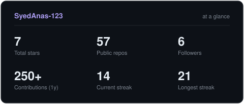
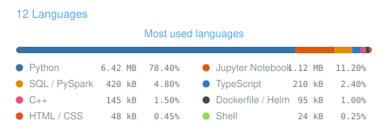

<!-- BANNER - terminal profile.sh --live -->
<picture>
  <source media="(prefers-color-scheme: dark)"  srcset="assets/banner-dark.v9.svg">
  <source media="(prefers-color-scheme: light)" srcset="assets/banner-light.v9.svg">
  
</picture>

 

<!-- NAME / TAGLINE - animated typing -->

 

<!-- SOCIALS -->
&nbsp;&nbsp;
&nbsp;&nbsp;
&nbsp;&nbsp;

  

---

## This is me :)

Hi, I'm **Syed Mohammad Anas Ahmed**, AI Engineer and Published Researcher, broadcasting from Karachi 🇵🇰.
I build production-grade intelligent infrastructure—from multi-tenant RAG pipelines to scalable LLM workflows—and I'm obsessed with translating theoretical AI concepts into robust, real-world systems.

- 🔭 **AI Engineering & Architecture**: architecting complex **LangChain / LangGraph** workflows, dynamic **vLLM** model routing, and multi-modal **RAG** pipelines with vector databases (FAISS, Qdrant, Pinecone, ChromaDB).
- 📄 **Published AI Researcher**: co-authored peer-reviewed studies on *GANs & Web Scraping for Financial Market Forecasting* (Innovative Computing Review) and *Quantum Machine Learning*.
- 👁️ **Computer Vision & Healthcare AI**: engineering real-time object detection, defect segmentation (**YOLO / OpenCV**), and diagnostic AI assistants.
- ⚡ **Full-Lifecycle MLOps**: deploying scalable microservices from research notebooks to production via **FastAPI, Docker, Kubernetes, Helm, and GitHub Actions CI/CD**.
- 🌐 **My Portfolio**: explore my live deployments and projects at **[syed-anas-portfolio.vercel.app](https://syed-anas-portfolio.vercel.app/)**.
- 💬 Talk to me about **LLMs, Agentic AI, Multi-Modal RAG, Computer Vision (YOLO), and MLOps** and you'll have my full attention.
 

## my perfect stack`

---

## signals 

<table>
<tr>
<td width="50%" align="center" valign="middle">

<picture>
  <source media="(prefers-color-scheme: dark)"  srcset="assets/radar-dark.svg">
  <source media="(prefers-color-scheme: light)" srcset="assets/radar-light.svg">
  
</picture>

</td>
<td width="50%" align="center" valign="middle">

<picture>
  <source media="(prefers-color-scheme: dark)"  srcset="assets/radar-langs-dark.svg">
  <source media="(prefers-color-scheme: light)" srcset="assets/radar-langs-light.svg">
  
</picture>

</td>
</tr>
</table>

---

## Numbers matter? ohhh yes. 

<picture>
  <source media="(prefers-color-scheme: dark)"  srcset="assets/card-stats-dark.svg">
  <source media="(prefers-color-scheme: light)" srcset="assets/card-stats-light.svg">
  
</picture>

 

---

` Build with love· @SyedAnas-123 `

