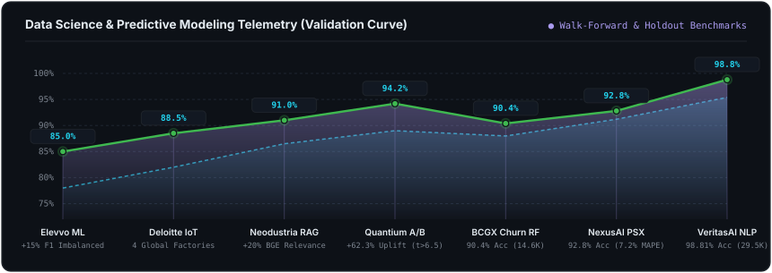
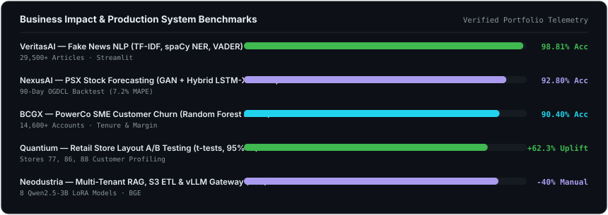

<!-- BANNER - terminal profile.sh --live -->
<picture>
  <source media="(prefers-color-scheme: dark)"  srcset="assets/banner-dark.v9.svg">
  <source media="(prefers-color-scheme: light)" srcset="assets/banner-light.v9.svg">
  
</picture>

 

<!-- NAME / TAGLINE - animated typing -->

 

<!-- SOCIALS -->
&nbsp;&nbsp;
&nbsp;&nbsp;
&nbsp;&nbsp;

  

---

## This is me :)

Hi, I'm **Syed Mohammad Anas Ahmed**, **Data Scientist / Analytics & AI Solution Engineer**, broadcasting from Karachi 🇵🇰.
I turn complex business data into measurable decisions through **statistical analysis, A/B testing, predictive modeling, ETL pipelines, and executive data storytelling**—while building toward **Data Strategy & Data Governance leadership**.

- 📊 **Data Science & Business Analytics**: experienced in hypothesis & A/B testing (**Quantium** — proved **+36.6% to +62.3%** retail sales uplift via t-tests at 95% CI), customer churn modeling (**BCGX** — **90.4% accuracy** across 14,600+ utility accounts), and IoT telemetry dashboards (**Deloitte** — multi-factory Tableau diagnostics).
- 🏛️ **Enterprise AI & Data Engineering at Neodustria (Basel, Switzerland)**: built multi-tenant S3 document ingestion ETL pipelines (**-40% manual handling**), production RAG search (**+20% relevance** via BGE/FAISS), and a **vLLM gateway serving 8 fine-tuned Qwen2.5-3B LoRA models** on Kubernetes with Helm, Prometheus & Grafana.
- 📈 **Financial & NLP Predictive Modeling**: engineered **NexusAI** (GAN + Hybrid LSTM-XGBoost forecasting for the Pakistan Stock Exchange achieving **92.8% accuracy / 7.2% MAPE**) and **VeritasAI** (Fake News NLP classifier with **98.81% accuracy** on 29,500+ articles).
- 📄 **Published Researcher**: co-authored peer-reviewed research on *GANs & Web Scraping for PSX Market Forecasting* (*Innovative Computing Review*) and *Hybrid GAN-LSTM-XGBoost with NLP Sentiment*.
- 🌱 **My Philosophy**: *"In the world of AI, I still bet on people."* — combining **Data Governance, Explainable AI (SHAP), and high-impact analytics** so institutions can trust their data.
- 💬 Talk to me about **Data Science, Predictive Modeling, A/B Testing, SQL/Spark ETL, Power BI/Tableau, and Enterprise AI** and you'll have my full attention.

 

## my perfect stack`

---

## signals 

<table>
<tr>
<td width="50%" align="center" valign="middle">

<picture>
  <source media="(prefers-color-scheme: dark)"  srcset="assets/radar-dark.svg">
  <source media="(prefers-color-scheme: light)" srcset="assets/radar-light.svg">
  
</picture>

</td>
<td width="50%" align="center" valign="middle">

<picture>
  <source media="(prefers-color-scheme: dark)"  srcset="assets/radar-langs-dark.svg">
  <source media="(prefers-color-scheme: light)" srcset="assets/radar-langs-light.svg">
  
</picture>

</td>
</tr>
</table>

 

<!-- NEW: Animated Data Science Area Graph -->
<picture>
  <source media="(prefers-color-scheme: dark)"  srcset="assets/area-analytics-dark.svg">
  <source media="(prefers-color-scheme: light)" srcset="assets/area-analytics-light.svg">
  
</picture>

  

<!-- NEW: Business Impact & Production Telemetry Bars -->
<picture>
  <source media="(prefers-color-scheme: dark)"  srcset="assets/impact-telemetry-dark.svg">
  <source media="(prefers-color-scheme: light)" srcset="assets/impact-telemetry-light.svg">
  
</picture>

 

<!-- Interactive Expandable Deep-Dive Matrix -->

<b>📂 Click to Expand: Interactive Case Studies &amp; Experience Telemetry</b>

 

| Domain / Organization | Role &amp; Pipeline Architecture | Key Statistical / Business Outcome |
| :--- | :--- | :--- |
| **BCGX** *(Boston, US · Remote)* | **Data Scientist (Simulation)** — Python EDA, log-transforms, feature engineering &amp; Random Forest churn modeling on 14,600+ SME accounts | **90.4% Accuracy**; proved customer tenure (18% peak churn at 2–4 yrs) &amp; net margin drive churn over price |
| **Quantium** *(Sydney, AU · Remote)* | **Retail Data Analytics (Simulation)** — A/B store layout trials (Stores 77, 86, 88), Welch's t-tests, 95% confidence intervals &amp; segment profiling | **+36.6% to +62.3% Sales Uplift** ($t > 6.5$) driven by new customer acquisition |
| **Neodustria** *(Basel, CH · Remote)* | **AI Engineer Intern** — Async S3 ETL ingestion, FAISS/BGE RAG pipelines, vLLM LoRA gateway (8 Qwen2.5-3B models) on Kubernetes &amp; Helm | **-40% Manual Handling**, **+20% Search Relevance**, **-25% Hallucinations**, **-50% Deployment Steps** |
| **Deloitte** *(Australia · Remote)* | **Data Analytics &amp; Forensic Tech** — 1-month IoT sensor telemetry across 4 global factories via interactive Tableau dashboards | Pinpointed top failing factory machinery (Laser Cutter &amp; Welder) for faster downtime diagnosis |
| **NexusAI** *(PSX Market Platform)* | **Lead Data Scientist (FYP)** — GAN synthetic data + Hybrid LSTM-XGBoost + NLP news sentiment &amp; SHAP explainability | **92.8% Forecasting Accuracy** (**7.2% MAPE**) on 90-day OGDCL walk-forward backtest |
| **VeritasAI** *(NLP Credibility Engine)* | **ML Engineer** — TF-IDF, spaCy NER &amp; VADER sentiment classification deployed via Streamlit | **98.81% Accuracy** across **29,500+ news articles** with live confidence scoring |

---

## Numbers matter? ohhh yes. 

<picture>
  <source media="(prefers-color-scheme: dark)"  srcset="assets/card-stats-dark.svg">
  <source media="(prefers-color-scheme: light)" srcset="assets/card-stats-light.svg">
  
</picture>

 

---

` Build with love · @SyedAnas-123 `

